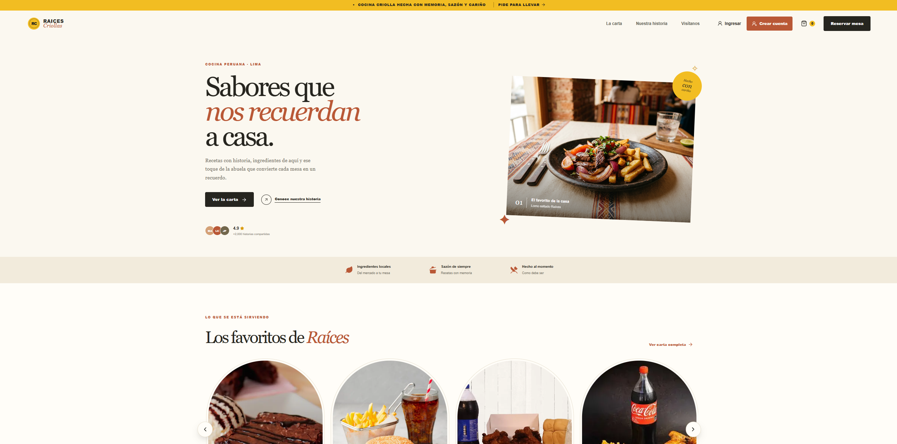
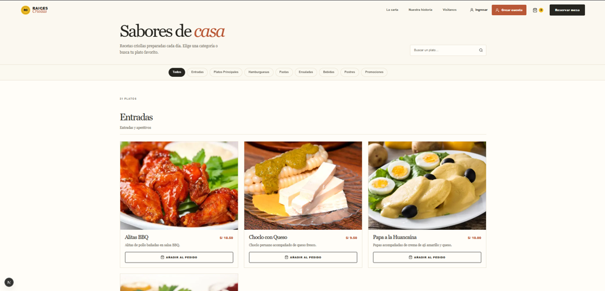
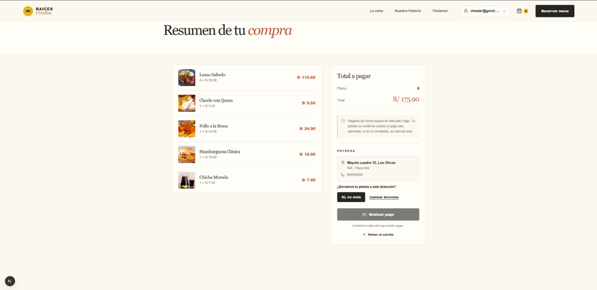
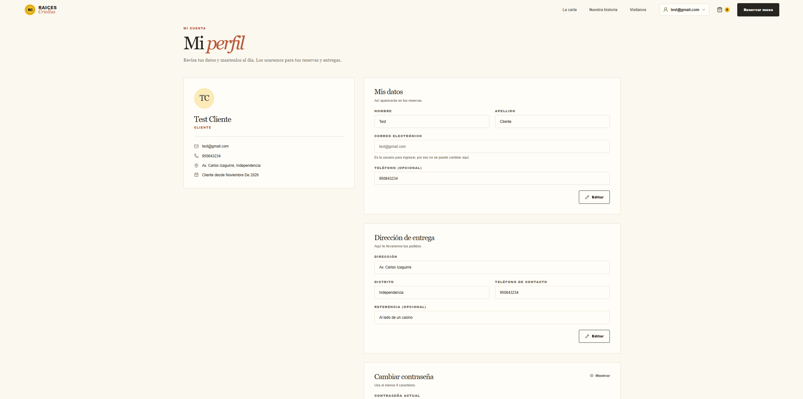
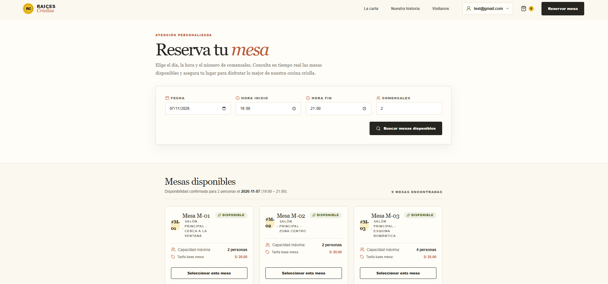
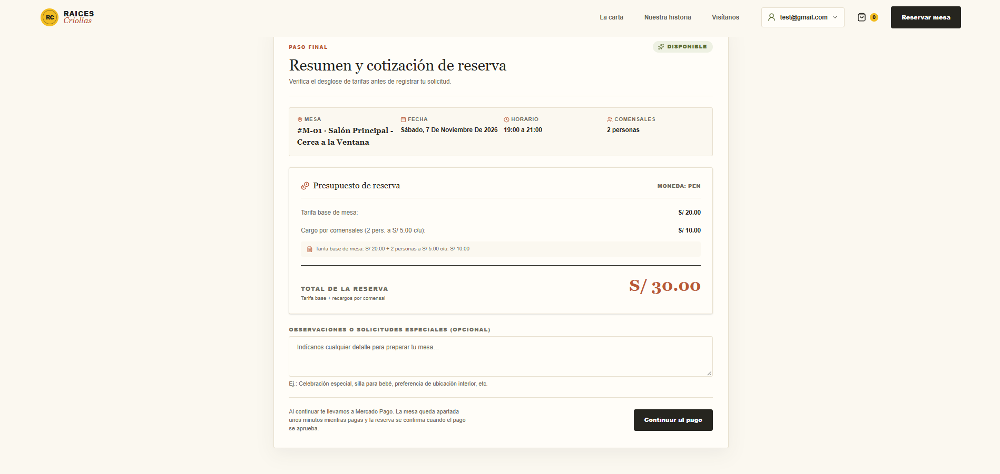
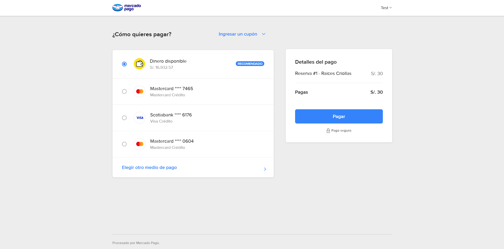
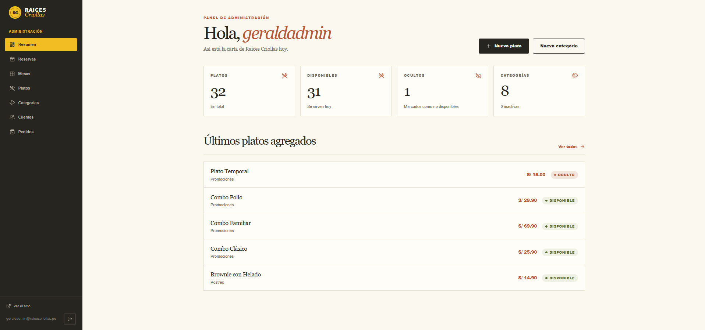
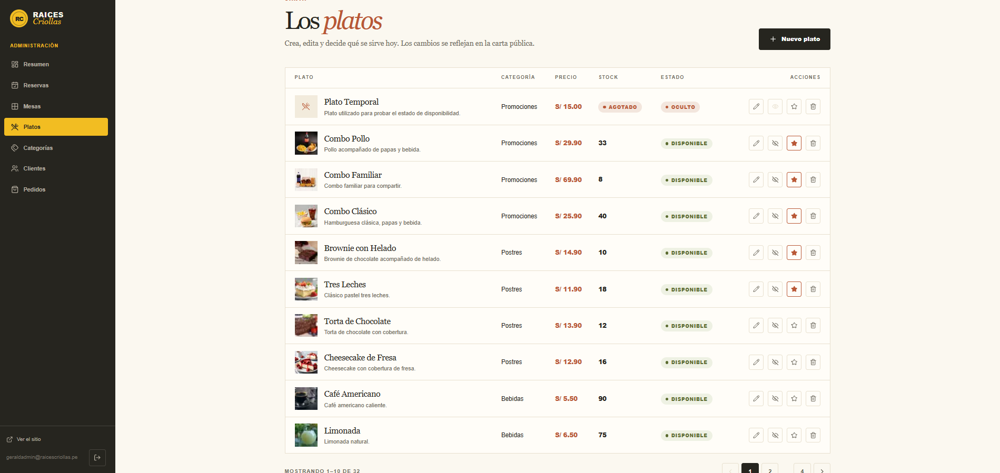
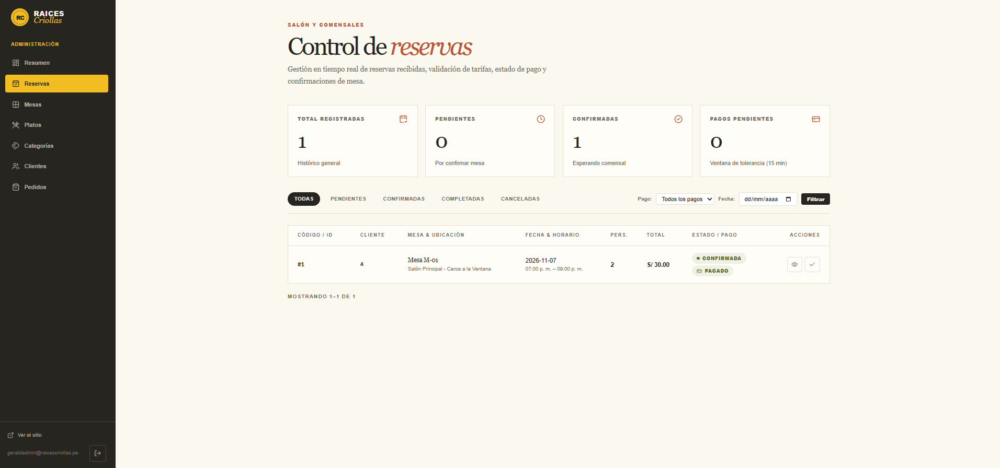

# 🍲 Raíces Criollas

¡Bienvenido a **Raíces Criollas**!  
Una aplicación web de **restaurante de comida criolla**, construida con un **frontend en Next.js** y una arquitectura de **microservicios con Spring Boot**, pensada para ofrecer una experiencia completa de pedidos en línea, reserva de mesas y pagos, junto con un panel para administrar el negocio.

Los clientes pueden explorar la carta, armar su carrito, pagar con **Mercado Pago**, reservar una mesa y consultar sus pedidos y reservas. El personal administrativo cuenta con un **panel de gestión** para platos, categorías, mesas, reservas, pedidos y clientes.

---

## 🛠️ Tecnologías Utilizadas - Frontend

- ▲ **Next.js (App Router)** – Framework principal. Renderiza las páginas en el servidor y usa *server actions* para hablar con el backend.
- ⚛️ **React 19** – Biblioteca para construir la interfaz con componentes reutilizables.
- 📘 **TypeScript** – Tipado estático para toda la lógica del frontend.
- 🎨 **Tailwind CSS v4** – Estilos mediante clases de utilidad; las animaciones y estilos complejos viven en `globals.css`.
- 📦 **pnpm** – Gestor de dependencias del proyecto.

---

## 🖥️ Tecnologías Utilizadas - Backend

- ☕ **Java 21 + Spring Boot** – Cada microservicio expone su propia API REST con su lógica de negocio.
- ☁️ **Spring Cloud Gateway** – Puerta de entrada única a toda la API.
- 🧭 **Eureka** – Registro y descubrimiento de los microservicios.
- 🗄️ **PostgreSQL** – Una base de datos independiente por microservicio.
- 🐇 **RabbitMQ** – Mensajería asíncrona entre los servicios.
- 🔑 **JWT** – Autenticación y autorización de usuarios.
- 🔨 **Maven** – Construcción y gestión de dependencias de cada servicio.

---

## ☁️ Servicios Externos e Infraestructura

- 🐳 **Docker y Docker Compose** – Levantan todo el sistema (frontend, microservicios, bases de datos y RabbitMQ) con un solo comando. Todos los contenedores usan la zona horaria de Lima (`America/Lima`).
- 💳 **Mercado Pago** – Pasarela de pago de pedidos y reservas.
- 🖼️ **Cloudinary** – Almacenamiento y entrega de las imágenes de los platos.

---

## 🍽️ Funcionalidades Principales

### 👤 Cliente

- 🔐 Registro e inicio de sesión.
- 🏠 Página de inicio con la presentación del restaurante.
- 📖 Carta de platos organizada por categorías.
- 🛒 Carrito de compras y resumen antes de pagar.
- 💳 Pago de pedidos con Mercado Pago (estados: exitoso, pendiente y fallido).
- 📋 Consulta de pedidos realizados.
- 🪑 Reserva de mesas, con el precio calculado por el sistema y pago en línea.
- 🗓️ Consulta y cancelación de reservas.
- 👤 Perfil del usuario y gestión de datos de entrega.

### 🔧 Administración

El panel administrativo está protegido mediante autenticación y autorización por rol.

- 📊 Panel de inicio del administrador.
- 🍲 Gestión de platos, incluido su stock.
- 🏷️ Gestión de categorías.
- 🪑 Gestión de mesas.
- 🗓️ Gestión de reservas.
- 📦 Gestión de pedidos.
- 👥 Consulta de clientes.

---

## 📸 Así luce la aplicación

### 🏠 Inicio

### 📖 Carta

### 🛒 Carrito

### 👤 Perfil de usuario

### 🪑 Reserva de mesa

### 💳 Pago con Mercado Pago

### 🔧 Panel de administración

| Inicio | Platos | Reservas |
| --- | --- | --- |
|  |  |  |
---

## 🏗️ Arquitectura del Proyecto

El sistema sigue una arquitectura de **microservicios**. El frontend nunca habla con un servicio directamente: todas las peticiones pasan por el gateway, que las dirige al servicio correspondiente gracias a Eureka.

~~~text
Navegador
   │
   ▼
Frontend (Next.js) ── puerto 3000
   │  server actions + JWT en cookie httpOnly
   ▼
Gateway ── puerto 8080
   │  descubre los servicios mediante Eureka (puerto 8761)
   ├── auth      ──► PostgreSQL (auth_db)
   ├── menu      ──► PostgreSQL (menu_db)      ◄──┐
   ├── pedidos   ──► PostgreSQL (pedidos_db)    ◄──┼── RabbitMQ
   ├── reservas  ──► PostgreSQL (reservas_db)
   └── payment   ──► PostgreSQL (payment_db) ──► Mercado Pago
~~~

### Estructura del repositorio

~~~text
.
├── docker-compose.yaml
├── .env                         (local, no se sube a Git)
├── dbInit/                      (scripts SQL con los datos iniciales)
├── raices-criollas-web/         Frontend (Next.js)
├── raices-criollas-gateway/     API Gateway
├── raices-criollas-eureka/      Registro de servicios
├── raices-criollas-auth/        Usuarios y autenticación
├── raices-criollas-menu/        Carta de platos
├── raices-criollas-pedidos/     Pedidos
├── raices-criollas-reservas/    Reserva de mesas
└── raices-criollas-payment/     Pagos con Mercado Pago
~~~

### Estructura del frontend

~~~text
raices-criollas-web/
└── app/
    ├── actions/        Server actions: llamadas al backend desde el servidor
    ├── components/     Componentes de interfaz (carta, carrito, reservas, pagos, admin...)
    ├── lib/            Cliente de la API y utilidades
    ├── types/          Tipos de TypeScript
    ├── admin/          Páginas del panel administrativo
    ├── carrito/        Carrito y resumen de compra
    ├── mis-pedidos/    Pedidos del cliente
    ├── mis-reservas/   Reservas del cliente
    ├── reservar-mesa/  Reserva de mesa
    ├── pago/           Resultado del pago (éxito, pendiente, error)
    └── page.tsx        Inicio
~~~

---

## 🧩 Responsabilidades de Cada Parte

| Parte | Responsabilidad |
| --- | --- |
| **Frontend (web)** | Mostrar la interfaz, validar la entrada del usuario y llamar a la API a través del gateway. No contiene reglas de negocio: por ejemplo, el precio de una reserva lo calcula el backend. |
| **Gateway** | Único punto de entrada a la API; enruta cada petición al microservicio que corresponde. |
| **Eureka** | Registro en el que se anuncian los servicios, para que se encuentren entre sí sin direcciones fijas. |
| **Auth** | Registro, inicio de sesión, usuarios y roles (cliente y administrador); emite los tokens JWT. |
| **Menu** | Categorías, platos, stock e imágenes (Cloudinary). |
| **Pedidos** | Creación y estados de los pedidos. Un pedido pasa a pendiente de pago al entrar a la pasarela y se cancela solo si vence sin pagarse. |
| **Reservas** | Mesas y reservas, cotización del precio y vencimiento del plazo de pago (15 minutos). |
| **Payment** | Creación de pagos en Mercado Pago, recepción de la confirmación y aviso a pedidos o reservas de que ya están pagados. |
| **RabbitMQ** | Mensajería asíncrona entre los servicios de menú y pedidos. |
| **PostgreSQL** | Cada servicio es dueño de su base de datos; ninguno lee la de otro. |

---

## 🔐 Autenticación y Seguridad

- 🔑 **JWT** – Al iniciar sesión, el servicio de autenticación emite un token firmado que los demás servicios validan.
- 🍪 **Cookie httpOnly** – El frontend guarda el token en una cookie que el JavaScript del navegador no puede leer; las llamadas al backend se hacen desde el servidor de Next.js.
- 🛡️ **Roles** – Las rutas y endpoints de administración solo aceptan usuarios con rol de administrador.
- 🤝 **Comunicación interna** – Los servicios se avisan entre sí (por ejemplo, payment a reservas) mediante un secreto compartido, sin exponer esos endpoints al público.
- 🗝️ **Variables de entorno** – Contraseñas, claves y tokens viven en el archivo `.env`, que no se sube al repositorio.

---

## 🚀 Instalación y ejecución

### Requisitos

- 🐳 **Docker Desktop** (incluye `docker compose`), con al menos 6 GB de RAM asignados.
- 🔧 **Git**.
- 📄 El archivo **`.env`** con las credenciales del proyecto (no está en el repositorio).

### 1. Clonar el repositorio

~~~bash
git clone <URL_DEL_REPOSITORIO>
cd <CARPETA_DEL_PROYECTO>
~~~

### 2. Configurar las variables de entorno

Crear un archivo `.env` en la raíz del proyecto, junto a `docker-compose.yaml`, con estas variables:

~~~bash
DB_USER=postgres
DB_PASSWORD=<contraseña>
JWT_SECRET=<cadena larga aleatoria>
INTERNAL_SECRET=<cadena larga aleatoria>
RABBITMQ_USER=raices_user
RABBITMQ_PASSWORD=<contraseña>
CLOUDINARY_CLOUD_NAME=<nombre de la cuenta>
CLOUDINARY_API_KEY=<clave>
CLOUDINARY_API_SECRET=<secreto>
MP_ACCESS_TOKEN=<token de Mercado Pago>
~~~

Si se ejecuta el frontend por separado, dentro de `raices-criollas-web` hace falta además un `.env` con `API_URL=http://localhost:8080`, `CLOUDINARY_CLOUD_NAME` y `CLOUDINARY_HOSTNAME`.

### 3. Levantar todo el sistema

~~~bash
docker compose up -d --build
~~~

La primera vez tarda varios minutos porque descarga imágenes y dependencias.

### 4. Abrir la aplicación

| Qué | Dirección |
| --- | --- |
| 🌐 Aplicación web | http://localhost:3000 |
| 🧭 Eureka (servicios registrados) | http://localhost:8761 |
| 🐇 RabbitMQ (panel de administración) | http://localhost:15672 |

### 5. Usuario administrador de prueba

Para entrar al panel administrativo (`/admin`):

| Rol | Correo | Contraseña |
| --- | --- | --- |
| 🔧 Administrador | `geraldadmin@raicescriollas.pe` | `admin123` |

> ⚠️ Es una credencial de demostración para el entorno local. Debe cambiarse antes de cualquier uso fuera de él.

### Comandos útiles

~~~bash
docker compose ps                 # estado de los contenedores
docker compose logs -f web        # registro de un servicio
docker compose down               # apagar (los datos se conservan)
docker compose down -v            # apagar y borrar todos los datos
~~~

> 📘 Para una guía paso a paso pensada para evaluación, consulta el **Manual de instalación y uso**.

---

## 📌 Notas

- El frontend se ejecuta en modo desarrollo dentro de Docker, por lo que la primera visita a cada página tarda unos segundos en compilarse.
- Los scripts de `dbInit` solo se aplican cuando el volumen de la base está vacío; para volver a cargarlos hay que usar `docker compose down -v`.